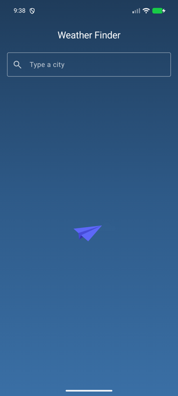
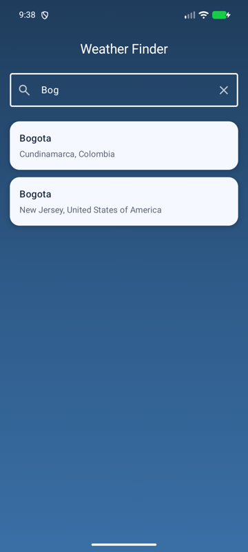
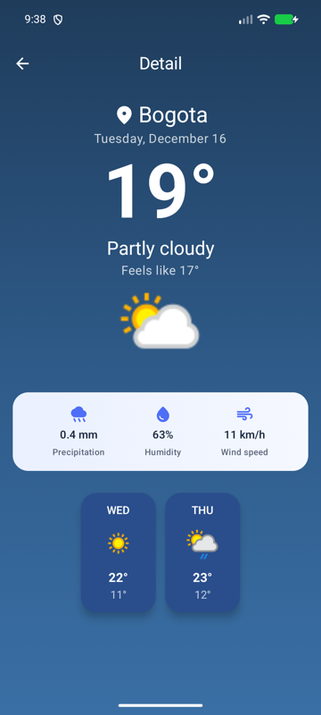
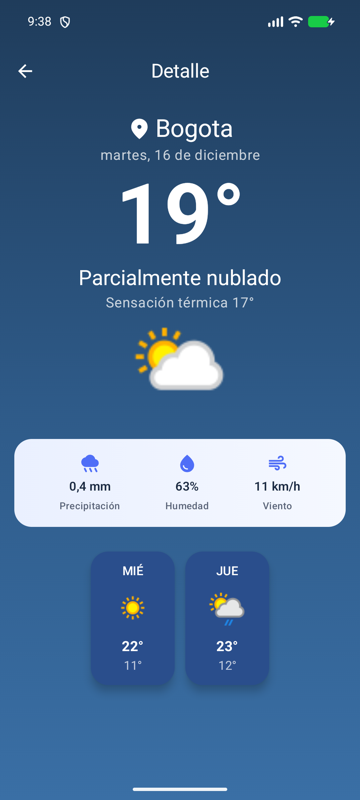
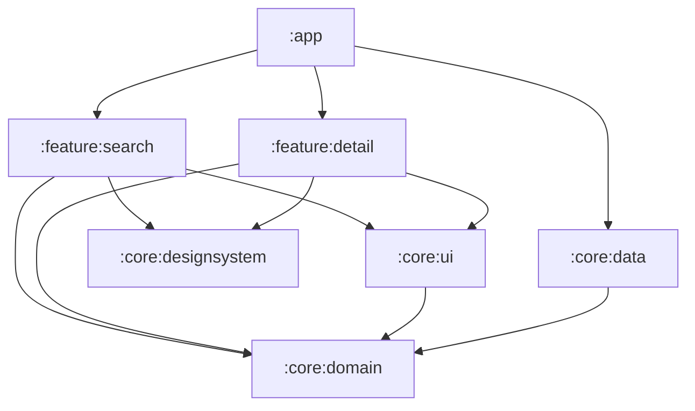

# WeatherApp 🌦️

[](https://github.com/Bikcodeh/weather-b/actions/workflows/ci.yml)

App Android nativa (Kotlin + Jetpack Compose) para buscar ciudades y consultar el clima actual y el
pronóstico de los próximos días con [WeatherAPI.com](https://www.weatherapi.com/).

El proyecto es una **referencia de Clean Architecture modular**: capas desacopladas y verificadas por
el compilador, MVVM con flujo de datos unidireccional, errores tipados, hilos inyectables y tests en
todas las capas.

| Búsqueda | Resultados | Detalle | Detalle (es) |
|:---:|:---:|:---:|:---:|
|  |  |  |  |

## ✨ Funcionalidades

- Búsqueda con *debounce* que distingue ciudades homónimas (región y país).
- Clima actual (temperatura, sensación térmica, precipitación, humedad y viento) y pronóstico.
- Estados de carga, vacío y error con reintento.
- Edge-to-edge, modo horizontal, accesibilidad (TalkBack) e idiomas inglés/español, incluidos los
  textos que devuelve el API.

## 🏗️ Arquitectura

Clean Architecture + MVVM/UDF, separada en módulos por capa y por feature:



| Módulo | Responsabilidad |
|---|---|
| `:app` | *Composition root*: `Application`, `MainActivity`, grafo de navegación y configuración (API key). |
| `:feature:search` | Pantalla de búsqueda: UI, `SearchViewModel` y su ruta de navegación. |
| `:feature:detail` | Pantalla de detalle: UI, `DetailViewModel` y su ruta de navegación. |
| `:core:domain` | **Kotlin puro**: modelos, errores (`DomainError`, `DomainResult`), contrato `WeatherRepository` y casos de uso. |
| `:core:data` | Implementación del repositorio: Retrofit, DTOs, mappers, mapeo de errores e inyección de dependencias. |
| `:core:ui` | Utilidades de UI que conocen el dominio (mensajes de error). |
| `:core:designsystem` | Tema, iconos y componentes Compose reutilizables. |
| `:core:testing` | Fakes, datos de prueba y `MainDispatcherRule` compartidos por los tests. |
| `build-logic` | Convention plugins de Gradle. |

```text
Compose UI ──evento──▶ ViewModel ──▶ UseCase ──▶ WeatherRepository ──▶ WeatherApi (Retrofit)
    ▲                      │
    └──── StateFlow<UiState> ◀── DomainResult ◀── mapeo DTO → dominio + DomainError
```

Decisiones, contratos de cada capa, hilos, navegación y estrategia de testing:
**[docs/ARCHITECTURE.md](docs/ARCHITECTURE.md)**.

## 🛠️ Stack

| Área | Tecnologías |
|---|---|
| Lenguaje | Kotlin 2.4, Coroutines + Flow |
| UI | Jetpack Compose (BOM 2026.09), Material 3, Navigation Compose 2.10 *type-safe*, Coil 3, Lottie |
| DI | Hilt 2.60 con KSP (sin kapt) |
| Red | Retrofit 3, OkHttp 5, kotlinx.serialization |
| Build | AGP 9.4 (Kotlin integrado), Gradle 9.6, *version catalog*, *convention plugins*, configuration cache |
| Calidad | Spotless + ktlint + Compose rules, Android Lint (warnings como errores), GitHub Actions, Dependabot |
| Tests | JUnit 4, AssertJ, Turbine, kotlinx-coroutines-test, MockWebServer, Robolectric + Compose UI Test |

## ✅ Tests

| Capa | Qué se verifica | Cómo |
|---|---|---|
| Dominio | Reglas de los casos de uso y `DomainResult` | JUnit + `FakeWeatherRepository` |
| Datos | Retrofit, serialización, interceptores y mapeo de errores (400/401/403/5xx, *timeout*, sin red, JSON inválido) | `MockWebServer` con respuestas reales del API |
| Presentación | Estados de los ViewModels: *debounce*, cancelación, reintento | Turbine + tiempo virtual |
| UI | Pantallas Compose: textos formateados, clicks y accesibilidad | Compose UI Test sobre Robolectric (JVM, sin emulador) |

## 🚀 Ejecutar

Requisitos: Android Studio reciente y JDK 17 o superior.

1. Crea una API key gratuita en [WeatherAPI.com](https://www.weatherapi.com/) y agrégala a
   `local.properties` (no se versiona):

   ```properties
   WEATHER_API_KEY=tu_api_key
   ```

   También se lee de la variable de entorno `WEATHER_API_KEY` (útil en CI).

2. Comandos principales:

   ```bash
   ./gradlew assembleDebug        # compila la app
   ./gradlew test                 # tests de todas las capas (JVM)
   ./gradlew lint spotlessCheck   # Android Lint + formato
   ./gradlew spotlessApply        # formatea el código
   ```

Para firmar el release, agrega un `keystore.properties` en la raíz con `storeFile`, `storePassword`,
`keyAlias` y `keyPassword`.

## 📁 Estructura

```text
weather-b
├── app/                    # Composition root (Application, MainActivity, NavHost, DI de configuración)
├── build-logic/convention/ # Convention plugins de Gradle
├── core/
│   ├── data/               # remote/ (API, DTOs, interceptores), mapper/, error/, repository/, di/
│   ├── designsystem/       # theme/, component/, icon/
│   ├── domain/             # model/, error/, result/, repository/, usecase/
│   ├── testing/            # Fakes y datos de prueba
│   └── ui/                 # Mensajes de error
├── feature/
│   ├── detail/             # DetailScreen, DetailViewModel, model/, component/, navigation/
│   └── search/             # SearchScreen, SearchViewModel, model/, component/, navigation/
└── docs/                   # Arquitectura e imágenes
```
